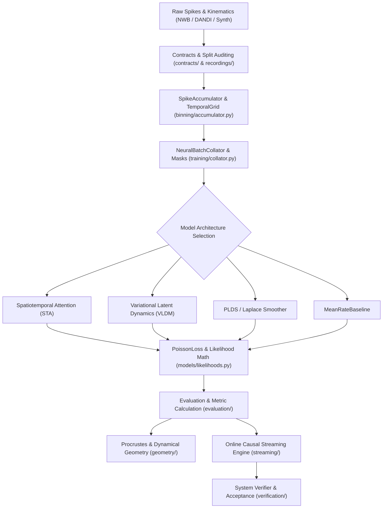
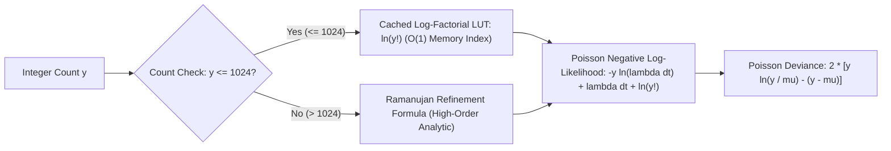
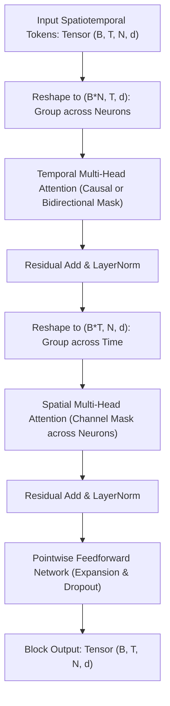
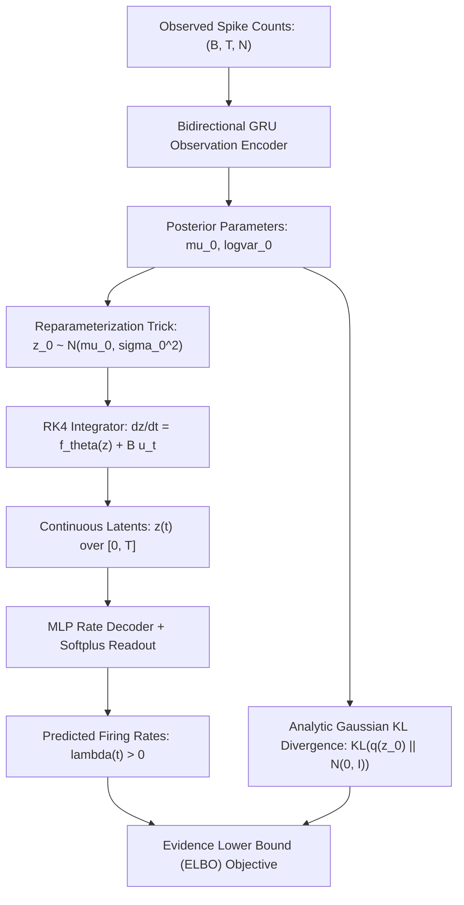
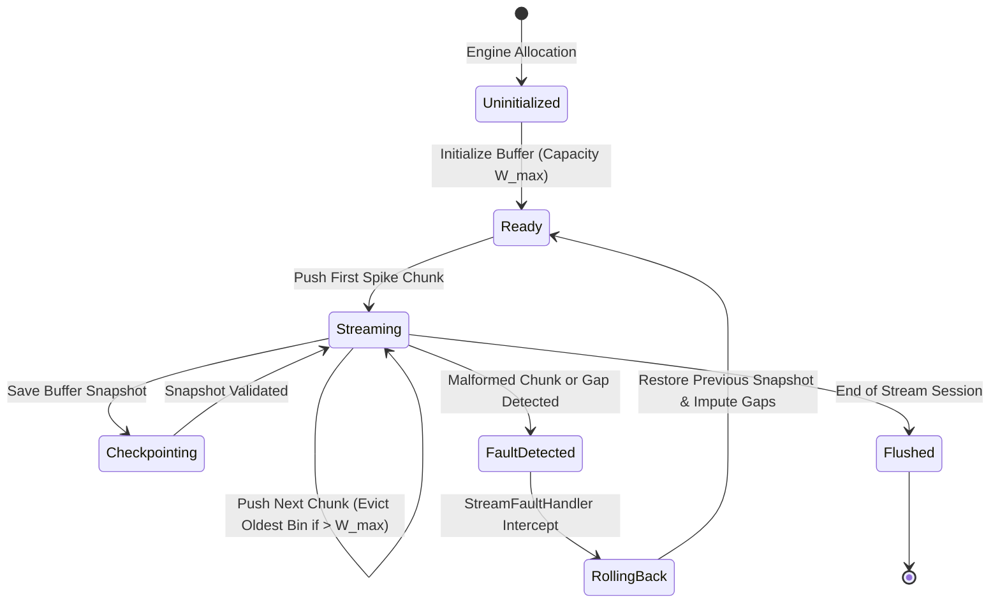
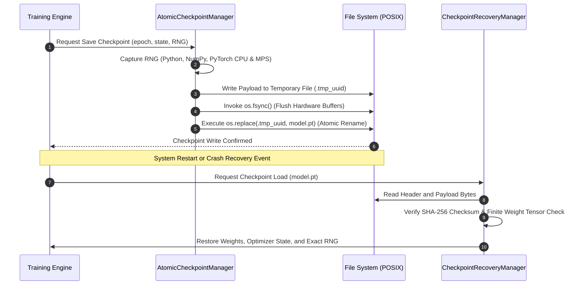
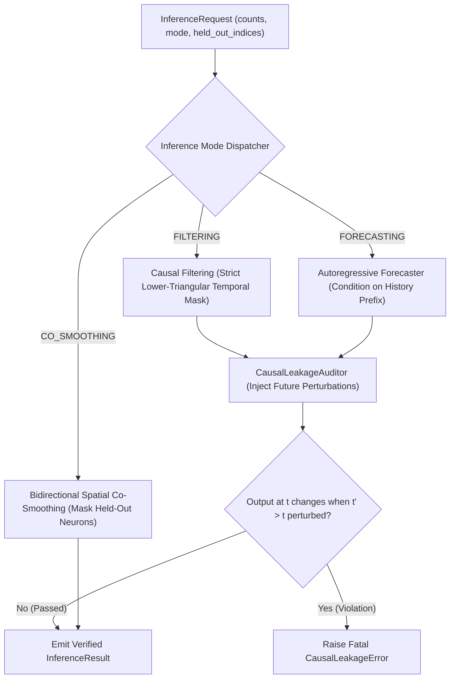
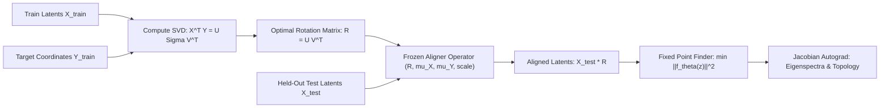
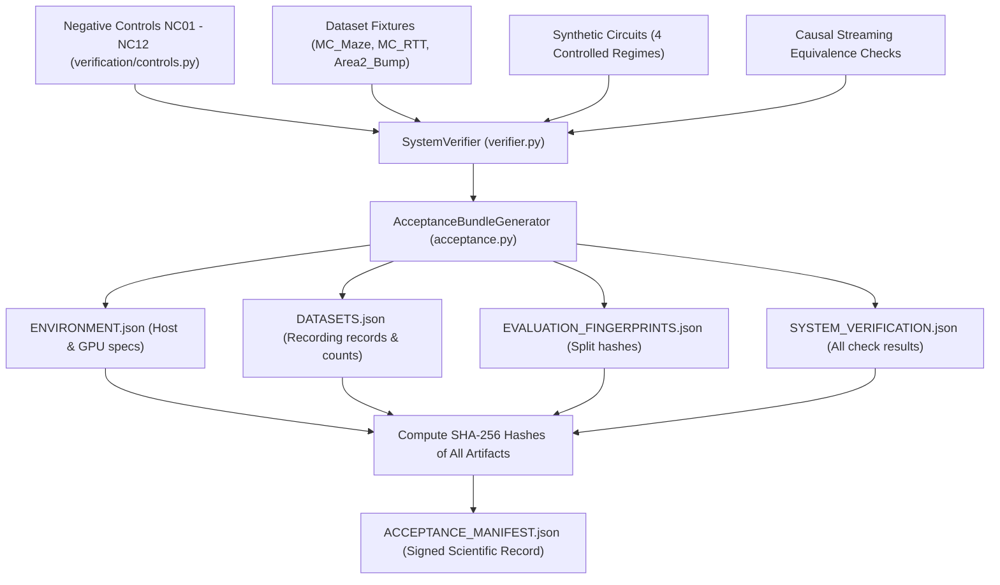
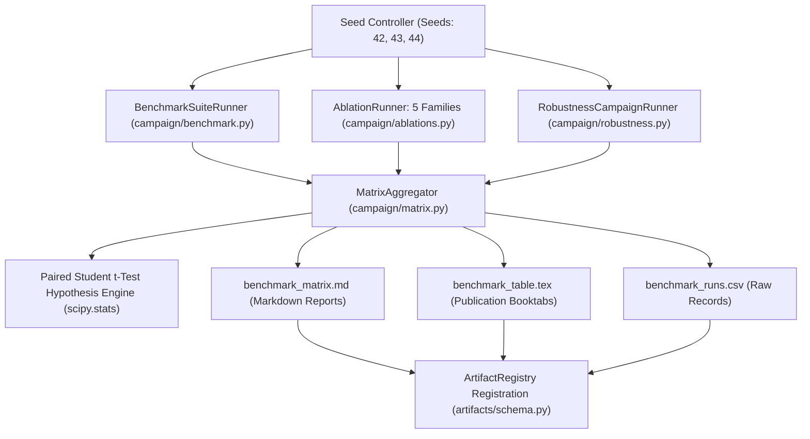

# Nocturne System Architecture and Theoretical Blueprint

This document details the architectural design, mathematical foundations, dataflow pipelines, and state machines governing the Nocturne probabilistic neural dynamics laboratory.

---

## 1. End-to-End Laboratory Dataflow

The laboratory processes continuous electrophysiological timestamps and kinematics into discrete tensors, trains probabilistic models, executes causal streaming inference, and evaluates out-of-sample dynamical geometry without data leakage.

---

## 2. Point-Process Observation Math and Stirling Lookup

Poisson log-likelihood computation evaluates integer spike counts $y \in \mathbb{Z}_{\ge 0}$ against predicted firing rates $\lambda \in \mathbb{R}^+$. A precomputed double-precision lookup table (LUT) eliminates runtime transcendental gamma evaluations for count values $k \le 1024$.

---

## 3. Axial Spatiotemporal Attention Factorization

Standard dense multi-head attention over space-time tokens costs $\mathcal{O}(B T^2 N^2 d)$. Nocturne factorizes attention into alternating temporal and spatial operations, reducing complexity to $\mathcal{O}(B N T^2 d + B T N^2 d)$.

---

## 4. Continuous-Time Variational Latent Dynamics (VLDM)

VLDM encodes neural population history into an initial variational latent distribution $q(z_0 \mid x)$ and integrates forward continuously via a parameterized vector field $dz/dt = f_\theta(z) + B u_t$ using fourth-order Runge-Kutta (RK4) integration.

---

## 5. Causal Streaming Engine and Ring Buffer State Machine

The online streaming engine ingests incoming neural packet chunks under real-time deadlines, maintains bounded circular history, and restores valid states upon detecting malformed telemetry.

---

## 6. Atomic Checkpointing and Fault Recovery Lifecycle

To prevent corrupted model checkpoints caused by premature process termination, Nocturne enforces atomic file writes via POSIX temporary file replacement and multi-RNG capture.

---

## 7. Inference Mode Routing and Causal Anti-Leakage Defense

The inference engine dynamically dispatches requests across Co-Smoothing, Causal Filtering, and Autoregressive Forecasting while actively auditing against future-data leakage.

---

## 8. Orthogonal Procrustes Gauge Alignment and Dynamical Geometry

Because unconstrained latent dynamics possess coordinate gauge ambiguity, Nocturne aligns learned trajectories to target systems using orthogonal Procrustes SVD fitted strictly on training data.

---

## 9. Acceptance Bundle and Cryptographic Manifest Verification

The verification suite runs system controls, asserts numerical exactness, benchmarks datasets, and compiles a cryptographically signed manifest for reproducible scientific audits.

---

## 10. Multi-Seed Campaign and Matrix Aggregation Architecture

The campaign package automates multi-seed model evaluation, 5-family ablation matrices, and robustness sweeps, serializing results to LaTeX, Markdown, and CSV tables.

